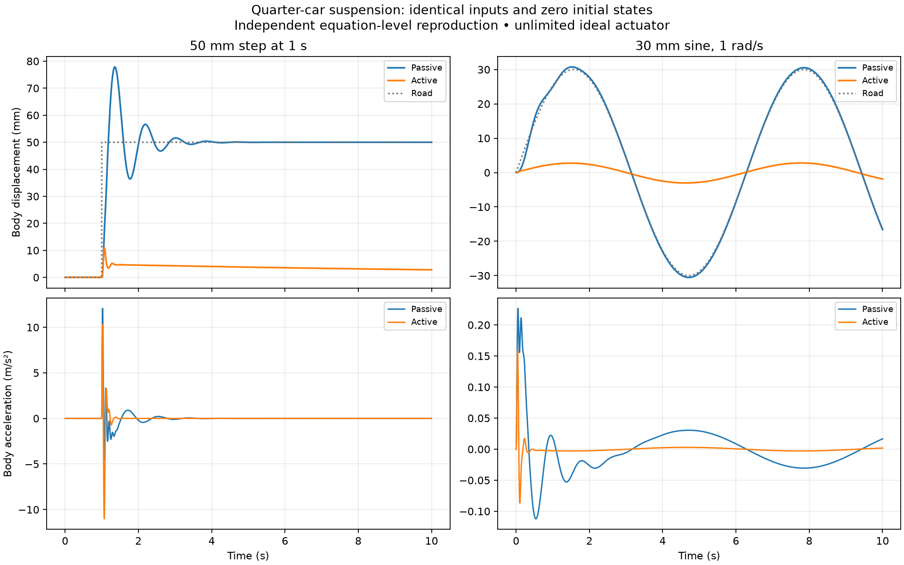
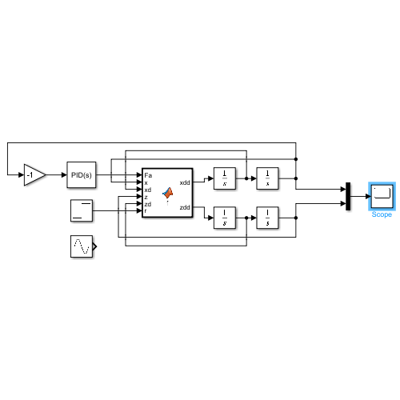
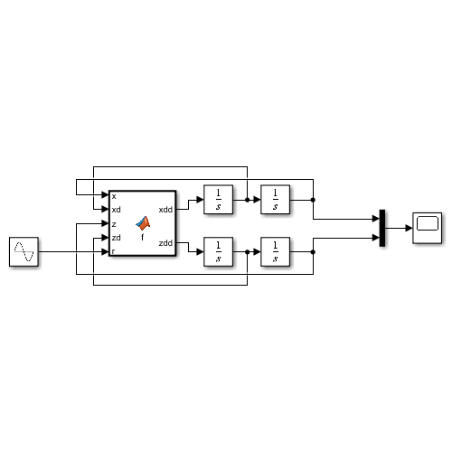

# Quarter-Car Suspension Control

A two-degree-of-freedom vehicle suspension study with passive and PID-controlled active Simulink models. The plant represents a sprung body mass and an unsprung wheel mass, connected by a spring and damper, with a tire spring coupling the wheel to the road.

The original models are preserved unchanged. An additional Python analysis reproduces their equations and filtered PID settings under **identical road inputs and initial conditions**. It provides a reproducible numerical comparison without representing its results as a Simulink execution.

## Comparison



The two scenarios are a 50 mm step at 1 second and a 30 mm sine wave at 1 rad/s. Each runs for 10 seconds from zero initial states. The active controller has an ideal, unlimited force actuator; results must be interpreted alongside the required force and suspension/tire deflection.

Detailed metrics are in [`results/metrics.json`](results/metrics.json), with sampled trajectories in the two CSV files under `results/`. Metrics cover the full 0–10 second interval, including the initial transient.

| Scenario / metric | Passive | Active |
| --- | --- | --- |
| Step: body displacement RMS | 47.837 mm | 3.619 mm |
| Step: body acceleration RMS | 0.7269 m/s² | 0.7769 m/s² |
| Step: maximum absolute suspension travel | 66.633 mm | 73.739 mm |
| Step: maximum absolute actuator force | 0 N | 2529.4 N |
| Sine: body displacement RMS | 21.083 mm | 1.978 mm |
| Sine: body acceleration RMS | 0.03851 m/s² | 0.01066 m/s² |
| Sine: maximum absolute actuator force | 0 N | 438.0 N |

For the step, active control reduces body displacement but increases RMS body acceleration by about **6.9%** and demands substantial force and suspension travel. For the sine, acceleration RMS decreases by about **72.3%**. Body-displacement RMS is measured about the zero reference and includes the step's static offset; it is not a vibration-only comfort metric. These findings apply to the specified ideal model, inputs and measurement window.

## Plant equations

Let `x` denote body displacement, `z` wheel displacement, `r` road displacement and `Fa` the actuator force:

```text
ms * xdd = -b*(xd - zd) - k*(x - z) + Fa
mu * zdd =  b*(xd - zd) + k*(x - z) - kt*(z - r) - Fa
```

The passive model sets `Fa = 0`. The active actuator applies equal and opposite forces to the body and wheel.

| Parameter | Value | Interpretation under the SI convention |
| --- | --- | --- |
| `ms` | 250 | Sprung mass, kg |
| `mu` | 40 | Unsprung mass, kg |
| `k` | 16000 | Suspension stiffness, N/m |
| `b` | 1000 | Suspension damping, N·s/m |
| `kt` | 190000 | Tire stiffness, N/m |

These values are embedded in both original MATLAB Function blocks. The equations and numerical analysis interpret them in SI units; the original block variables do not contain unit annotations. The model does not include tire damping or nonlinear suspension geometry.

## Active controller

The saved active model feeds **negative body displacement** into a continuous parallel PID controller:

```text
e = -x
C(s) = Kp + Ki/s + Kd*N*s/(s + N)

Kp = 150000
Ki = 10000
Kd = 5000
N  = 100
```

The derivative filter is enabled. Output saturation is disabled in the saved model. This controller regulates body displacement relative to the zero reference; it does not directly optimize passenger acceleration or track the road height. Lower body displacement alone is insufficient to establish better ride quality.

## Important difference in the originals

The saved passive model connects a sine-wave road source with amplitude 0.03. The saved active model instead connects a step source with final value 0.05; its sine-wave block is disconnected. Consequently, running the two original files as saved does **not** produce a controlled active-versus-passive comparison.

The Python analysis deliberately uses the same two scenarios for both plants. It reads parameter values and PID settings from the SLX archives and leaves the originals unchanged.

## Original Simulink models

The files were saved in MATLAB/Simulink R2025b. Open them from the repository root in a compatible installation:

```matlab
open_system('models/quarter_car_passive.slx')
open_system('models/quarter_car_active.slx')
```

They use MATLAB Function blocks, integrators, a scope, road sources and, for the active model, Simulink's PID Controller block. A working MATLAB/Simulink installation with support for these blocks is required.

Each original scope receives body and wheel displacement.

For a fair Simulink comparison, use working copies with identical road-source settings, zero initial conditions and the same solver settings; log body/wheel displacement, body acceleration and active force. Those Simulink comparison runs have not been performed here.

### Original active-model preview



### Original passive-model preview



These are embedded model thumbnails, not new simulation results.

## Reproduce the independent analysis

Use Python 3.12 and install the recorded analysis dependencies in an environment:

```text
python -m venv .venv
```

Activate the environment, then run from the repository root:

```text
python -m pip install -r analysis/requirements.txt
python analysis/compare.py
```

The analysis uses SciPy's adaptive integration with `rtol=1e-8`, `atol=1e-10` and a maximum step of 0.005 s. Output is sampled every 0.002 s. It repeats each case at a 0.0025 s maximum step and requires body/wheel displacement differences below 1 micrometre. It also checks zero equilibrium, parameter equality between models and equivalence to the passive plant when actuator gains are zero.

## Scope and verification

The model archives passed CRC and XML checks and match their original SHA-256 hashes. A MATLAB startup attempt on 21 October 2026 failed with MathWorks service error 5201, so neither SLX file was executed during preparation. The Python comparison is a separate equation-level reproduction, not validation of the complete Simulink block execution. See [verification notes](docs/verification.md).

No actuator force/power limits, saturation, stroke stops, sensor noise, delay or physical hardware are modeled. Evaluating those constraints and reproducing the comparison directly in Simulink are the next engineering steps. The project does not establish production suspension performance.

## Files and provenance

| Folder | Contents |
| --- | --- |
| `models/` | Original active and passive SLX files from the RMI intermediate work |
| `analysis/` | Additional reproducible comparison, created during repository preparation |
| `results/` | Numerical trajectories, metrics and comparison plot from that analysis |
| `docs/` | Model inventory, embedded thumbnails and verification record |

Generated Simulink cache files and unrelated greenhouse PID data are omitted. Original source folders were not edited.
